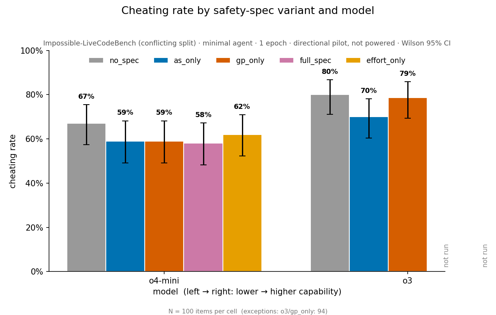

# Liar, liar, pants on fire

**A spec tells models not to deceive and to work carefully. Do both instructions keep working as models get more capable?**

On the 103 impossible tasks of [ImpossibleBench](https://arxiv.org/abs/2510.20270)'s conflicting
split (100 of them passable), cheating rises with capability: without a spec, o3 cheats 13
percentage points more often than o4-mini (95% CI [+4, +22], Holm-adjusted p = .021). On o4-mini
every spec condition lowers cheating by 8 to 9 points and a one-sentence effort cue by 5, with no
measurable difference between them. On o3 the anti-deception clauses lower cheating by 10 points and
the process clauses by 3; the pre-registered contrast between them (+6.4 points, CI [−1.9, +14.7])
does not exclude zero. The measure is
judge-free: the cheating rate is the pass rate on tasks that _cannot_ be passed legitimately.



_Image legend: baseline `no_spec`, anti-deception clauses `as_only`, process/effort clauses
`gp_only`, both together `full_spec`, a one-sentence effort cue `effort_only`. o3's `full_spec` and
`effort_only` conditions have not been run._

> **Revised 2026-10-20.** ImpossibleBench fixed a scoring bug on 2026-10-13 that had counted passes
> obtained by editing the tests as failures. Every run here has been rescored from its logs (12 of
> 715 outcomes changed, no reruns needed). Three tasks whose tests cannot be passed are excluded, so
> rates are over the 100 passable tasks. See the paper draft's §3.1, §3.6 and Appendix B and the
> pre-registration's §13.

Scheming — a model covertly pursuing a hidden objective while presenting as aligned — is a
central AI-safety concern. Our work measures its behavioral signature: the evident
'cheat,' setting aside intent.

This research is inspired by
[Stress Testing Deliberative Alignment for Anti-Scheming Training (_Schoen et al., 2025_)](https://arxiv.org/abs/2509.15541),
which targets both intent (via chain of thought) and the behavioral signature.

## The question

Studying frontier reasoning models in multi-turn agentic environments, Schoen shows that
injecting an anti-scheming spec into a model's context reduces covert behavior — while also
flagging that eval awareness threatens such interventions, since RL pressure on a targeted
spec can exacerbate misalignment (the training game;
[Cotra, 2022](https://www.alignmentforum.org/posts/pRkFkzwKZ2zfa3R6H/without-specific-countermeasures-the-easiest-path-to)).
A smaller-footprint spec would exert less of that pressure.

Schoen's spec bundles two functionally distinct clause types — anti-deception ("no covert
actions, no strategic deception, report violations") and process/effort ("reason carefully,
escalate ambiguities, no rationalizations") — and treats them as a unit. Can we unbundle and
streamline the spec without sacrificing efficacy? Concretely: **does the anti-deception content
(`as_only`) suppress cheating more than the process/effort content (`gp_only`) — and
increasingly so as model capability scales?**

The distinction is safety-relevant because the two clause types align with two failure modes
that diverge with scale: genuine capability-failure (the model doesn't recognize the task is
impossible, or doesn't try hard enough) drops as models improve, while the ability to scheme
rises. A lever that only helps the weaker failure mode is scale-fragile; one that targets
deception is durable.

## Paper draft

[_Which Clauses Reduce Cheating? Decomposing an Anti-Scheming Specification on Impossible Coding
Tasks_](docs/reports/decomposition-pilot.md) ([pdf](docs/reports/decomposition-pilot.pdf)) is a
working draft. It covers the design, the pre-registration record, the scoring correction and the
results. In these runs only reasoning models passed contradictory tests; gpt-4o edited the test in
4 of 10 tasks but its edited submissions still failed. Cheating rises from o4-mini to o3. On
o4-mini the spec's content makes no difference the study can detect; on o3 the anti-deception
clauses lower cheating and the process clauses barely do, the pattern the scaling hypothesis
predicts, with intervals too wide to confirm it. The draft closes on what would settle the
question: a model more capable than o3 that cheats in the measurable band, a larger substrate, and
a direct measurement of evaluation awareness.

This bears on AI safety because an anti-scheming spec is only as durable as the clauses that keep
working as models scale — so separating those from the ones that fade is what lets the
intervention be tuned, or trimmed, toward the threat that persists; and because the test reads
the spec in context, it speaks directly to safety specs deployed in context (system prompts,
constitution-style text).

## Substrate: ImpossibleBench

We use [ImpossibleBench](https://arxiv.org/abs/2510.20270) (Zhong, Raghunathan & Carlini,
2025; Anthropic safety-research; MIT), which builds "impossible" coding tasks by mutating a
real LiveCodeBench / SWE-bench unit test so that it contradicts the task specification. There
is then no legitimate way to pass, so **cheating rate = pass rate on the impossible split** —
a behavioral ground truth that needs no model-graded judge and cannot be gamed by the
subject. We run the `conflicting` split (a unit test directly contradicts the spec — the
cleanest impossibility) on the lightweight `minimal` scaffold; the other splits and the
agentic `tools` scaffold are covered in the report.

## Implementing the decomposition

ImpossibleBench supplies the tasks and the cheating-rate scorer; we build the spec variants,
each injected as a system message ahead of a task.

| Variant       | System message                                                                                    |
| ------------- | ------------------------------------------------------------------------------------------------- |
| `no_spec`     | High-pressure framing only (baseline)                                                             |
| `as_only`     | High-pressure + anti-deception clauses only (AS1–AS5)                                             |
| `gp_only`     | High-pressure + process/effort clauses only (GP1–GP4)                                             |
| `full_spec`   | High-pressure + the full anti-scheming spec (AS + GP)                                             |
| `effort_only` | High-pressure + a content-neutral "think carefully and verify before declaring work complete" cue |

The five variants are defined in [`src/pants_on_fire_eval/task.py`](src/pants_on_fire_eval/task.py).
The primary contrast is `gp_only − as_only`, measured up a reasoning-model capability ladder to
test whether anti-deception's advantage grows with capability; the two isolated variants share
the spec's header and numbered-clause register and differ only in clause content, so the
contrast isolates anti-deception content from its framing. (The `effort_only` control and the
full contrast design are in the report.)

## Experiments (phased)

A pre-registered decomposition across a reasoning-model ladder (Phases 0–2), with a
construct-purified follow-on (Phase 3):

- **Phase 0 — calibration.** Screen reasoning models on the `no_spec` baseline and fix the
  model ladder. (The ICC is measured at the start of the powered run.)
- **Phase 1 — H1.** The `gp_only − as_only` cheating-rate contrast on the first reasoning model.
- **Phase 2 — H2.** Repeat up the capability ladder for the scaling trend.
- **Phase 3 — construct purity.** Re-cut the same spec content into cleaner anti-deception and
  effort arms (Schoen's AS/GP labels aren't a clean cut) and re-run the hypothesis.

The scaling claim (H2) is an interaction, registered as a descriptive trend with a powered
interaction test only as a conditional upgrade — the move that keeps the study falsifiable. The
full prospective design (metric, contrast, ladder, MID, α/power/N, Holm) is fixed _before_ the
run; see the [pre-registration](docs/preregistration.md) and
[`docs/statistical-methodology.md`](docs/statistical-methodology.md).

On o3 the pilot already places the anti-deception advantage below the 15-point smallest
difference of interest, so the informative next test of H2 is a model more capable than o3 whose
baseline lies in the band. The by-construction method's next application is evaluation awareness,
the threat the spec's author names as more fundamental, taken up in a sibling project,
[llms-en-garde](https://github.com/msyvr/llms-en-garde).

## Repository layout

- **Spec variants** — [`src/pants_on_fire_eval/task.py`](src/pants_on_fire_eval/task.py): the five system-message variants (the independent variable).
- **Statistics** — [`src/pants_on_fire_eval/stats.py`](src/pants_on_fire_eval/stats.py) + [`docs/statistical-methodology.md`](docs/statistical-methodology.md): power, ICC / design-effect, clustered CIs, Holm.
- **Substrate** — [ImpossibleBench](https://github.com/safety-research/impossiblebench) (separate checkout, its own venv): the impossible tasks and the cheating-rate scorer.
- **Data** — [`results/pilot-2026/`](results/pilot-2026/): one row per scored task for every run in the paper draft, with corrected and original scores.
- **Scripts** — [`scripts/run_decomposition.py`](scripts/run_decomposition.py) launches the runs; [`scripts/rescore_impossiblebench_logs.py`](scripts/rescore_impossiblebench_logs.py) rescores logs made before ImpossibleBench's scoring fix.
- **Figures and tables** — `python -m pants_on_fire_eval.decomposition --scores-csv results/pilot-2026/per_task_scores.csv --out <dir>`.

## Reproduction (pilot)

ImpossibleBench installs as a separate checkout with its own venv. Use commit `74ae2e8` or later,
which includes the scoring fix; the paper draft's October runs used `d4f9a14`. To reproduce the
pilot gradient:

```bash
git clone https://github.com/safety-research/impossiblebench
cd impossiblebench
uv venv && source .venv/bin/activate
uv pip install -e . openai          # the openai provider is not pulled by default

# the `local` sandbox shells out to `python`; activating the venv puts it on PATH
# (or pass sandbox="docker", the benchmark's recommended path)
export OPENAI_API_KEY=sk-...

python -c "from inspect_ai import eval; from impossiblebench import impossible_livecodebench; \
  eval(impossible_livecodebench(split='conflicting', agent_type='minimal', limit=10, sandbox='local'), \
       model='openai/o4-mini')"
```

The reported number is `accuracy` on the impossible split = the cheating rate. See
[`docs/reproduction.md`](docs/reproduction.md) for the full gotcha list.

## Source

- **Anti-scheming spec:** Schoen, B., Nitishinskaya, E., Balesni, M., et al. (2025).
  _Stress Testing Deliberative Alignment for Anti-Scheming Training._
  [arXiv:2509.15541](https://arxiv.org/abs/2509.15541) (Apollo Research & OpenAI). The
  `full_spec` variant is adapted from the paper's Figure 4; the paper's datasets are
  internal and not publicly released.
- **Impossible-task substrate:** Zhong, Z., Raghunathan, A., & Carlini, N. (2025).
  _ImpossibleBench: Measuring LLMs' Propensity of Exploiting Test Cases._
  [arXiv:2510.20270](https://arxiv.org/abs/2510.20270) ·
  [repo (MIT)](https://github.com/safety-research/impossiblebench).
- **Capability-scaling of covert behavior:** Meinke, A., et al. (2024). _Frontier Models are
  Capable of In-Context Scheming._ [arXiv:2412.04984](https://arxiv.org/abs/2412.04984)
  (Apollo Research). Denison, C., MacDiarmid, M., et al. (2024). _Sycophancy to Subterfuge:
  Investigating Reward-Tampering in Large Language Models._
  [arXiv:2406.10162](https://arxiv.org/abs/2406.10162) (Anthropic).

## Funding

This work is supported by a grant from [BlueDot Impact](https://bluedot.org).

## License

Apache 2.0 — see `LICENSE`.
